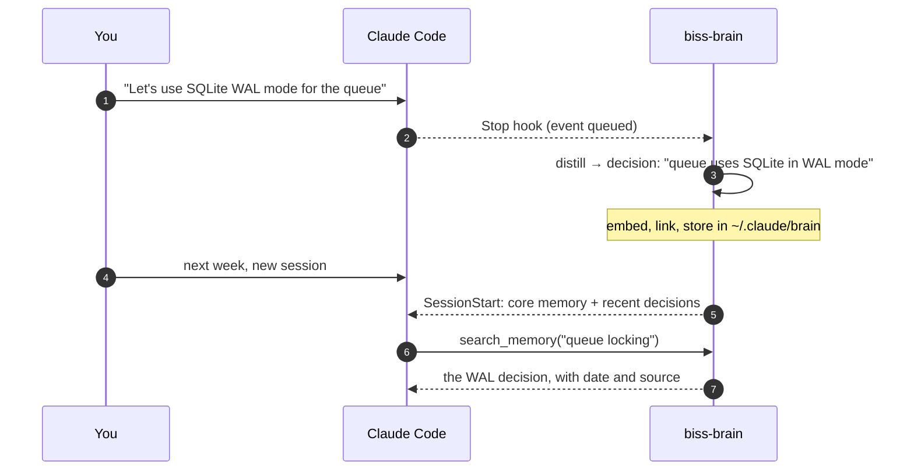

<p align="center">
  <picture>
    <source media="(prefers-color-scheme: dark)" srcset="docs/assets/banner-dark.svg">
    
  </picture>
</p>

<p align="center">
  <a href="LICENSE"></a>
  
  
  
</p>

biss-brain gives Claude Code a memory that lasts beyond one session. While you work, it
quietly notes the decisions, fixes and lessons from each conversation. When you come back to the
project, Claude starts with what matters already in context, and can search the rest.

Everything is stored on your machine. Embeddings run locally through [Ollama](https://ollama.com),
the index is [LanceDB](https://lancedb.com) plus SQLite, and the model calls (turning a
transcript into short notes) go through your own Claude Code login. No API key, no cloud service.

## How it works

<p align="center">
  <picture>
    <source media="(prefers-color-scheme: dark)" srcset="docs/assets/pipeline-dark.svg">
    
  </picture>
</p>

1. **Capture.** Claude Code hooks (`Stop`, `SubagentStop`, `PreCompact`, `SessionEnd`) write a
   tiny event and return at once, so your session never waits on the brain.
2. **Distill.** A background daemon reads each finished stretch of conversation, strips
   `<private>` blocks and secrets, and asks Claude (Haiku by default) for a few short, typed
   notes: decisions, lessons, schemas, tasks.
3. **Store.** Notes are embedded locally with `nomic-embed-text` and stored per project, with
   links between related notes and a judge that marks outdated facts as superseded.
4. **Recall.** New sessions start with your core memory and the latest decisions for the project.
   Claude can search more through an MCP tool, and so can you with `/biss-brain:recall`.
5. **Dream.** Every night at 03:00 a launchd job refreshes links, sweeps for contradictions,
   decays stale notes and condenses whole sessions into summaries. It only adds; it never deletes.



## Requirements

- **macOS.** The nightly jobs use launchd. The hooks may work elsewhere, but only macOS is tested.
- **[uv](https://docs.astral.sh/uv/)** (`brew install uv`). It builds the plugin's Python
  environment, about 1 GB, since the reranker pulls in PyTorch.
- **[Ollama](https://ollama.com)** (`brew install ollama`), running, for local embeddings.
- **Claude Code**, with the `claude` CLI logged in. Distillation runs `claude -p` on your
  subscription.

## Install

In Claude Code:

```
/plugin marketplace add Bissbert/biss-brain
/plugin install biss-brain@bissbert
/biss-brain:install
```

`/biss-brain:install` builds the environment, pulls `nomic-embed-text`, writes
`~/.claude/brain/config.toml` and schedules the nightly job. Restart Claude Code afterwards so the
hooks and the MCP server load, then run `/biss-brain:doctor` to check every dependency.

Expect the brain to stay quiet for the first session or two on a project: nothing is recalled
until something has been distilled.

### Updating

`/plugin update biss-brain@bissbert`, or let Claude Code auto-update the marketplace. Each
version gets a fresh plugin folder; on the first session after an update the plugin rebuilds its
environment in the background (a few minutes, announced at session start) and the nightly job
follows the new version by itself.

## Privacy

- **Stored locally.** Memories live in `~/.claude/brain/`, one folder per project. Embedding,
  indexing and search all run on your machine.
- **Claude calls go through your login.** Distilling notes, judging conflicts and the nightly
  session summaries run `claude -p` with your Claude Code login, the same service your sessions
  already talk to. Nothing goes anywhere else.
- **Scrubbed first.** Secrets (API keys, access tokens, private keys, passwords in URLs, other
  high-entropy strings) are removed before anything is distilled or embedded. Wrap text in
  `<private>…</private>` to keep it out entirely.
- **Scoped.** Your home folder itself, `~/Downloads`, `~/Library`, `~/.claude` and `/tmp` are
  excluded by default. Drop a `.biss-brain-ignore` file in any project to switch it off there.
- **Local UI.** The web UI binds to `127.0.0.1` only; it loads one chart library from a CDN.

## Commands

| Command | What it does |
|---|---|
| `/biss-brain:install` | Build the environment, pull the embedding model, write config, schedule the nightly job. `--with-dmn` adds idle-time maintenance. |
| `/biss-brain:doctor` | Check every dependency and the store; says what to fix. |
| `/biss-brain:recall <query>` | Search this project's memory. |
| `/biss-brain:remember <text>` | Save a memory yourself. `--core` makes it core memory, injected every session. |
| `/biss-brain:core` | Review and accept the core-memory proposals Claude and the dream pass make. |
| `/biss-brain:forget <id>` | Retire a memory so it stops being recalled. |
| `/biss-brain:inject on\|off\|status` | Per-prompt injection for this project (off by default). |
| `/biss-brain:stats` | Counts and health for this project. |
| `/biss-brain:ui` | Open the local web UI. |

### Hooks and tools in detail

| Trigger | Behaviour |
|---|---|
| `Stop` hook | Queues a small event (transcript offset) after every assistant turn. The session segment is distilled once, when it closes. |
| `SubagentStop` hook | Queues a per-sub-agent event; a subagent's own transcript is distilled 10 s after it stops. |
| `SessionEnd` hook | Closes the session's segment. |
| `PreCompact` hook | Closes the segment and writes a digest of the conversation tail, then returns at once. The segment is distilled in the background (Sonnet). |
| `SessionStart` hook | Injects core memory in full (see below), then the top-3 recent decisions for the project. Also fires after `/clear`. |
| `SessionStart` (compact) | Re-injects core memory and this session's pre-compaction summary. If the summary is not distilled yet, it injects the conversation-tail digest instead, and the summary follows once on the next prompt. |
| `UserPromptSubmit` hook | Off by default (`[retrieve] user_prompt_inject`). When on, it injects at most one memory that clears the calibrated gate, once per session, within a 2.5 s deadline. |
| `/biss-brain:recall <q>` | Manual hybrid search of the project brain. |
| `/biss-brain:remember <text>` | Explicit user-curated memory (kind=decision auto-pins). `--core [--shared\|--global]` writes core memory instead. |
| `/biss-brain:core` | Show, review, accept or reject core-memory proposals; `shared on\|off`; `export` an `@import` line. |
| `/biss-brain:inject` | Prompt injection for this project: `on`, `off`, or `status` (gate, latency p50/p95, outcomes). |
| `/biss-brain:ui` | Launch a local web UI to browse and inspect the brain (see below). |
| MCP tool `search_memory` | Model-initiated retrieval during work. |
| MCP tools `core_propose_add` / `core_propose_remove` | The model suggests core changes; nothing changes until `/biss-brain:core accept`. |

## Web UI

`/biss-brain:ui` starts a local FastAPI server (random free port, `127.0.0.1` only) and opens your browser. Re-running the command reuses the live server. `/biss-brain:ui --stop` shuts it down.

Five panels:

| Panel | What it shows |
|---|---|
| **Search** | Hybrid BM25+vector query over the project, with kind filter, pin/unpin, forget. |
| **Sessions** | Index of recent sessions; per-session replay with chronological chunks, agent lanes, and supersession chains. |
| **Timeline** | Stacked daily histogram of captures by kind, plus mean decay over time. |
| **Scatter** | UMAP 2D projection of the project's embeddings, colored by kind, sized by decay, click to inspect. Cached at `ui/projections/<hash>_proj.parquet` with 1-hour TTL and incremental `umap.transform()` for new chunks. |
| **Graph** | A-MEM backlink network rendered with Cytoscape (cola force layout), hub detection, neighborhood expansion. |

The UI is read-only by design except for pin/unpin/forget actions, which update SQLite + LanceDB the same way the slash commands do. Cytoscape is vendored under `ui/static/`; Observable Plot loads from CDN. The server runs detached, survives terminal exit, and writes to `~/.claude/brain/ui.log`.

## Core memory

A small curated set of notes injected in full at every session start, ahead of recalled memory.
It comes in three layers, injected in this order:

| Layer | File | Written by |
|---|---|---|
| shared | `<repo>/.claude/brain/CORE.md`, committed with the code | You, with `--core --shared` or by hand. Injected only after you opt in for that repo (`/biss-brain:core shared on`); a cloned repo's file is never injected on its own. |
| private (default) | `~/.claude/brain/core/<repo>.md` | You. |
| global | `~/.claude/brain/core/_global.md` | You, with `--core --global`. |

- The files are the source of truth. Bullets carry `<!-- m:<id> <date> <source> -->`. Hand edits
  win, and deleting a line retires the memory; `core.sqlite` keeps each item's versions.
- Live core is written by `/biss-brain:remember --core`, `/biss-brain:core accept` and hand
  edits. Both commands are user-invoked only (`disable-model-invocation`). The plugin's MCP tools
  and the dream pass can only add proposals, because core skips the taint filter that keeps tool
  and web content out of injection. A model that runs the scripts through Bash still goes
  through Claude Code's Bash permission prompt.
- `~/.claude/brain/core/` is a git repo, committed on every change under the identity
  `biss-brain`, without signing and without touching your git config. A hand edit holding a
  secret-shaped line is never staged, by that commit or a later one. `/biss-brain:doctor`
  points at it, and injection and `/biss-brain:core` scrub on read.
- At most `[core] max_items` (200) bullets are injected, project layers first. Any extra items
  are announced in the injected text, never dropped silently. Doctor warns at `warn_ratio` (80%).
- If Claude Code's built-in auto memory is also on, doctor says so. To keep only biss-brain
  core, set `"autoMemoryEnabled": false` in `~/.claude/settings.json`.

## Configuration

Edit `~/.claude/brain/config.toml`. Defaults are sensible. Common knobs:

```toml
[distill.models]
stop = "haiku"            # cheap; called many times per session
subagent_stop = "haiku"
pre_compact = "sonnet"    # one call per compaction; quality matters
conflict_judge = "haiku"

[debounce]
segment_idle_seconds = 600  # a session segment closes after 10 min without a Stop
segment_max_events = 20     # … or at 20 Stops, at SessionEnd, or at PreCompact
subagent_stop_seconds = 10

[scope]
exclude = ["~", "~/Downloads", "~/Library", "~/.claude", "/tmp"]  # "~" exactly, the rest as trees
include_only = []           # set it to capture only under these directories
```

To turn the brain off for one project, add a `.biss-brain-ignore` file, or
`.claude/brain.toml` with `enabled = false`, at its root (or any parent).
Excluded and opted-out directories stop in `_run.sh` before Python starts.

## Uninstall

Run the uninstall script from the installed plugin folder first, then remove the plugin:

```bash
cd ~/.claude/plugins/cache/bissbert/biss-brain/<version>
./uninstall.sh                # stops the jobs, removes the runner and the venv; keeps memories
./uninstall.sh --purge-data   # also deletes ~/.claude/brain (asks first)
```

```
/plugin uninstall biss-brain@bissbert
```

Without `--purge-data`, your memories stay in `~/.claude/brain/`, so a reinstall picks up where
you left off.

## Documentation

- [docs/internals.md](docs/internals.md): stack, storage layout, the flush daemon, the dream
  pass, which mechanisms are on and why, known limits, roadmap.
- [docs/README.md](docs/README.md): the research and design notes behind it.
- [CHANGELOG.md](CHANGELOG.md)

## License

[MIT](LICENSE) © Bissbert
